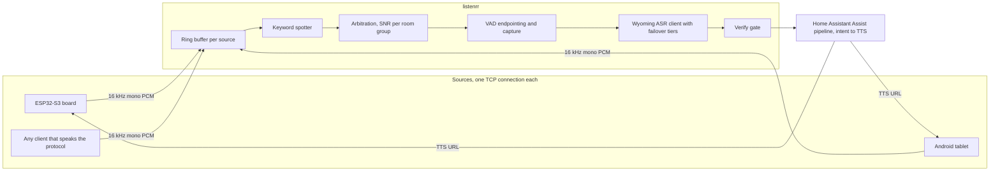

# listenrr

[](https://github.com/carrion256/listenrr/actions/workflows/ci.yml)

A central voice backend for Home Assistant. Cheap microphones stream raw audio to one server. The
server does the wake word detection, picks the best microphone, captures the request, transcribes
it, and hands the text to a Home Assistant Assist pipeline. The reply is played back on the speaker
that heard you.

The wake word is a text file, not a trained model. Change `luna` to anything you can say and
restart the service.

> **Status: released as is, not maintained.** This ran a real house (ESP32-S3 boards and Android
> tablets in several rooms). It was built for one household, one Home Assistant and one language, and the
> author is not planning to develop it further. Fork it, take what is useful, ignore the rest. Issues
> and pull requests may sit unread.

## Why do wake detection on the server

Most DIY voice satellites run the wake word model on the device. That works, but it ties you to
whatever the device firmware can run. Here the satellite is a dumb microphone and the model runs on a
machine that has room for a better one.

- **Arbitrary wake words.** The keyword spotter is open vocabulary. A wake word is a line of tokens in
  `config/keywords.luna.txt` plus the spellings your ASR produces for it in `kws.wake_words`. No
  training run, no sample collection, no model file per phrase. Several keywords can run at once,
  each with its own boost.
- **One place to tune.** Thresholds, boosts and the verify gate live in one config file. Changing them
  does not mean reflashing nine boards.
- **Whole-house arbitration.** Every source in a room group streams into its own ring buffer. When two
  microphones hear the same "luna", the backend compares their signal to noise ratio and one wins. The
  other stays quiet.
- **Evidence for every decision.** Each trigger leaves a WAV and a JSON sidecar with the transcript,
  scores, winner and stage timings. A false accept becomes a test fixture you can replay offline.
- **Dumb satellites are cheap satellites.** The firmware streams PCM and plays audio. It has no
  models, no wake word logic and very little to go wrong.

The cost: audio leaves the room, over your LAN, to your server. Nothing here talks to a cloud service,
but if you are not comfortable with an always-streaming microphone on your network, device-side wake
words exist for a reason.

## How it works



1. A source connects over TCP, says hello, and streams 64 ms audio frames.
2. Every frame goes into that source's 15 second ring buffer and through the keyword spotter.
3. A keyword hit opens a short arbitration window. The source with the best signal to noise ratio in
   the room group wins the session, and the others are suppressed.
4. Voice activity detection finds the start of the utterance in the buffered audio and then the end
   in the live stream. Because the ring holds audio from before the hit, you do not have to wait
   for the wake word to finish.
5. The audio goes to a Wyoming ASR service (tested with Parakeet). More than one tier can be
   configured, for example a GPU box first and a CPU container behind it.
6. The verify gate requires one of the configured `kws.wake_words` to appear in the transcript as a
   whole word. Rejected triggers are saved to `clips/false_accept/` and never reach Home Assistant.
   This is what lets the spotter be loose: it proposes, the transcript decides.
7. The text enters a Home Assistant Assist pipeline at the intent stage. The TTS result comes back
   as a URL and is played by the winning source or by a Home Assistant `media_player`.
8. A follow-up window keeps the conversation open so you can answer without saying the wake word again.

A bare spoken "stop" ends the conversation. With the optional stop keyword file configured, saying the
wake word plus "stop" over a playing reply interrupts it before any transcript exists. See
[`docs/protocol.md`](docs/protocol.md) for how the stop control reaches each kind of source.

## What is in the repository

| Path | What it is |
|---|---|
| `src/` | The backend, in Rust. `kws`, `capture`, `coordinator`, `parakeet` (Wyoming client), `ha` (Home Assistant client), `ingest` (TCP listener), `verify`, `clips`, `replay` |
| `firmware/components/luna_stream/` | ESPHome external component that streams the microphone and plays replies. Written against the Waveshare ESP32-S3-AUDIO board |
| `config/satellite.example.yaml` | An ESPHome config for that board that uses the component |
| `tablet/` | A small Android app that turns a tablet into a source with a speaker. Built with plain `javac` and the Android SDK, no Gradle |
| `docs/protocol.md` | The wire format. Enough to write a source in any language |
| `docs/deployment.md` | Running it for real: systemd, a container, where to put the ASR, measured wake word settings |
| `docs/design/` | The original engineering notes and test records, kept for the reasoning |
| `config/listenrr.toml.example` | Every config key, its default and which ones are required |
| `deploy/listenrr.service` | A hardened systemd unit |
| `justfile` | Build, test, deploy and firmware recipes (`just --list`) |

## Quick start

You need three things this repository does not provide:

- A **Home Assistant** with an Assist pipeline, a long-lived access token and the pipeline id.
- A **Wyoming ASR** service reachable as `host:port`. This was developed against
  [`lmoe/wyoming-onnx-stt`](https://github.com/lmoe/wyoming-onnx-stt) running Parakeet TDT 0.6b-v3.
- A **source**: an ESP32-S3 board with the firmware component, the Android app, or your own client.

Build and test (the tests are fully offline):

```sh
cargo build --release
cargo test
```

The first build downloads a prebuilt `sherpa-onnx` static library. To build offline, point
`SHERPA_ONNX_ARCHIVE_DIR` at a directory containing the archive.

Fetch the keyword spotter and VAD models, pinned by digest:

```sh
./scripts/get_models.sh --dest models
```

Copy and edit the config. The example marks every required key:

```sh
sudo install -d /etc/listenrr
sudo cp config/listenrr.toml.example /etc/listenrr/listenrr.toml
sudo cp config/keywords.luna.txt /etc/listenrr/keywords.txt
```

Check it without opening a socket or contacting anything:

```sh
./target/release/listenrr health --config /etc/listenrr/listenrr.toml
```

Run it:

```sh
./target/release/listenrr run --config /etc/listenrr/listenrr.toml
```

Logs are JSON on stderr and the filter comes from `RUST_LOG`. For a long-running install use the unit
in `deploy/listenrr.service` and read [`docs/deployment.md`](docs/deployment.md).

## Choosing a wake word

`kws.keywords_file` holds one keyword per line, spelled in the tokens of the model, not in English.
The model is a BPE-style zipformer, so "luna" is `▁ LU N A`. The tokenizer that ships with
sherpa-onnx produces this form:

```sh
sherpa-onnx-text2token --tokens models/kws/<bundle>/tokens.txt 'computer'
```

Matching is an exact token sequence. A spelling the model never emits fires on nothing, silently. In
this project's tests `▁ HE Y ▁ LU N A` (a space after the first marker) never fired, because the model
produces `▁HE` as a single token, while `▁HE Y ▁ LU N A` worked. Test a new word against recordings
before you trust it: replay them and look at what fires.

Then tell the verify gate what the transcript will say. In `[kws]`:

```toml
wake_words = ["computer"]   # every spelling your ASR may produce; "computer's" is accepted automatically
```

The default is `["luna", "lunar", "loona", "lunas"]`. Without this the gate rejects every trigger
whose transcript lacks one of those words.

```sh
./target/release/listenrr replay --config /etc/listenrr/listenrr.toml clips/
```

Thresholds default to loose on purpose. A false accept is cheap because the verify gate drops it and
keeps the clip. A miss is the failure you notice. `docs/deployment.md` has the keyword set and
threshold matrices that were measured, including the token defect above.

## Sources

**ESP32-S3 (ESPHome).** Add `firmware/components/luna_stream` as an external component and start from
`config/satellite.example.yaml`. It targets the Waveshare ESP32-S3-AUDIO (ES7210 microphone ADC,
ES8311 speaker codec) and is based on a community ESPHome package for that board. Other I2S boards
need their own pin and codec sections. The wire codec in `luna_stream.h` is tested against the Rust
implementation byte for byte in `tests/wire_contract.rs`.

**Android tablet.** `tablet/` builds an app that streams the tablet's microphone and plays the reply
itself, so the tablet does not need a Home Assistant `media_player`. See `tablet/README.md`.

**Anything else.** A source is a TCP client: one hello line, then tagged binary frames. The
protocol is in [`docs/protocol.md`](docs/protocol.md), with the exact bytes of every message. A
Raspberry Pi with a USB microphone and a short script is enough.

## Offline tools

```sh
listenrr replay [--config <path>] [--model <dir>] <wav or directory>   # whole pipeline on a WAV
listenrr bench-kws --model <dir> --wav <wav>                           # spotter speed
```

`replay` runs keyword spotting, capture, transcription and the verify gate on a file and prints a
JSON report per clip plus the worst utterance end margin, which is the number that
`capture.trailing_silence_ms` moves. A `<name>.transcript.json` next to a clip skips the ASR call, so
you can tune offline.

## What was measured and what was not

- The keyword spotter ran at about 32 times real time on one core of an Intel N100 with a single
  stream. The design target for eight concurrent streams was never run.
- ASR on a GPU transcribed 2 seconds of audio in about 0.12 seconds. A CPU tier behind it took 1.6 to
  4.4 seconds on an idle host and about 10 seconds on a loaded one.
- The wire protocol, arbitration, the state machine and the verify gate are covered by unit tests and
  by socket-level tests over real TCP. The firmware codec is compared against the Rust codec byte
  for byte.
- Whole-house latency from "luna" to the first audible word was not measured systematically, and
  there is no accuracy benchmark for the wake word on diverse speakers or noisy rooms. The model is
  English only.
- Wake detection on one dialect, in one house, is evidence about that house.

## Known limits

- English. The spotter model and the verify gate assume it.
- No speaker identification. Anyone who says the wake word gets an answer.
- No TLS on the source socket. Run it on a trusted LAN, set `server.auth_token`, and put a VPN or
  firewall in front of anything else. Without a token every hello is accepted and the service logs a
  warning at startup.
- Clips are household audio stored on disk for 30 days by default. Decide where that lives and
  whether it is backed up.
- The deploy recipes in the `justfile` assume a Proxmox container reached over SSH. They are
  worked examples, not a general installer.

## Documentation

- [`docs/protocol.md`](docs/protocol.md): the source protocol
- [`docs/deployment.md`](docs/deployment.md): deployment, ASR placement, wake word measurements
- [`docs/design/CONTRACT-NOTES.md`](docs/design/CONTRACT-NOTES.md): frozen interfaces and why
- [`docs/design/TEST-NOTES.md`](docs/design/TEST-NOTES.md): acceptance status and the tuning log
- [`config/listenrr.toml.example`](config/listenrr.toml.example): every setting

## Licence

Dual licensed under either of [Apache License 2.0](LICENSE-APACHE) or [MIT](LICENSE-MIT), at your
option. See [`NOTICE.md`](NOTICE.md) for third-party components and models.
