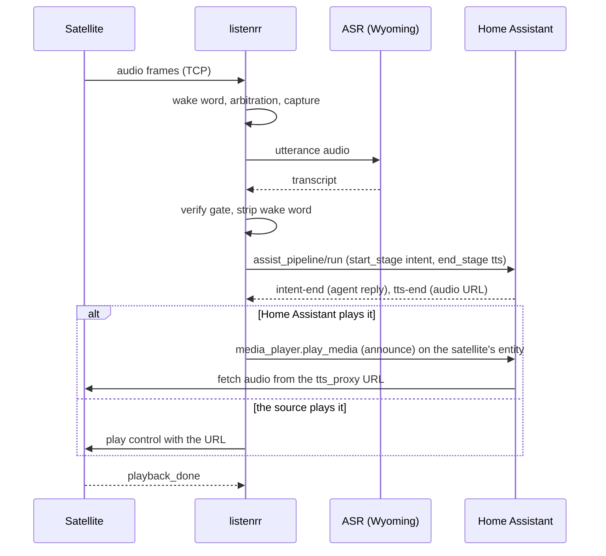

# Home Assistant setup

listenrr does not replace Home Assistant's voice stack. It replaces the part in front of it:
wake word, capture and speech to text. From the text onward it uses your existing Assist pipeline,
so whatever conversation agent and TTS voice you already have keep working.

## What happens to one request



- listenrr starts the pipeline at the intent stage (`start_stage: "intent"`, `end_stage: "tts"`)
  and sends the transcript as `input.text`. Home Assistant's own speech to text is never used, so
  the pipeline's STT setting does not matter to listenrr.
- Whatever the pipeline names as its conversation agent answers: Home Assistant's built-in
  intents, an LLM integration such as OpenAI, or a local model. The conversation id is the
  listenrr session id, so a follow-up turn continues the same conversation without the wake word.
- The pipeline's TTS stage produces the audio, and Home Assistant returns a `/api/tts_proxy/...`
  URL for it. Any TTS integration works, including one with a custom voice. The run this project
  was developed against used an ElevenLabs TTS entity with a custom voice, and its audio came back
  as MP3 (`audio/mpeg`). listenrr takes the format from the `mime_type` in `tts-end` and
  understands MP3 and FLAC. See
  [`tests/fixtures/ha-run-2026-11-02.json`](../tests/fixtures/ha-run-2026-11-02.json) for the exact
  events Home Assistant 2026.9.2 sent.
- The run carries the source's Home Assistant `device_id`, so the conversation agent can resolve
  "the lights in here" to the right area. Set `device_id` on the `[[sources]]` entry (or
  `fallback_device_id` for a source with no device of its own).

## Using Hermes as the conversation agent

This is how the author's house runs. [Hermes Agent](https://github.com/NousResearch/hermes-agent) exposes an
[OpenAI-compatible API server](https://hermes-agent.nousresearch.com/docs/user-guide/features/api-server). The pipeline's
conversation agent is [Extended OpenAI Conversation](https://github.com/jekalmin/extended_openai_conversation) (a custom
integration, MIT licensed) pointed at the endpoint of the Hermes profile that is the household
assistant.

1. Run Hermes with its API server enabled. It requires an API key and refuses to start the
   endpoint without one. Keep the endpoint on your LAN or behind a reverse proxy that limits who
   can reach it.
2. Install Extended OpenAI Conversation in Home Assistant and add a service. Give it Hermes's base
   URL (the `/v1` root) and that key as the API key.
3. Add a conversation agent from that service and set it as the conversation agent of the pipeline
   you give listenrr in `ha.pipeline_id`. Set the pipeline's TTS to the voice you want. The author
   uses an ElevenLabs entity with a custom voice, so the assistant has its own voice.

The author's agent options:

| Option | Value |
|---|---|
| Prompt template | `You are Luna, the household voice assistant for this Home Assistant. Answer in plain text only, one or two short sentences.` |
| Chat model | any non-empty name. Hermes ignores the model a client sends and uses the model set in its own profile config |
| Maximum tokens to return | 1024 |
| Top P | 0.9 |
| Temperature | 0.4 |
| Maximum function calls per conversation | 12 |
| Functions | the integration's standard `execute_services` function, which lets the agent call Home Assistant services on entities exposed to it. Copy it from the integration's README |

From then on, `assist_pipeline/run` from listenrr reaches Hermes with the transcript as the user
message, and Hermes's reply is spoken. Because the agent keeps its own memory and tools, it can
answer questions and run tools, not only match Home Assistant intents, and it keeps context between
turns. The model Hermes uses is Hermes's own configuration and is invisible to listenrr.

Two practical notes:

- Voice replies should be short. The prompt above asks for one or two plain sentences for that
  reason: a long answer is a long wait before the TTS audio exists, and markdown is read aloud by
  the TTS.
- An empty request is never sent. A bare wake word strips to nothing, and listenrr drops it before
  the pipeline so the agent never sees an empty message.

## Steps

### 1. Pick or create the pipeline

In Home Assistant, open **Settings, Voice assistants**, and choose the pipeline whose conversation
agent and TTS voice you want. You need its id. Current Home Assistant does not serve the pipeline
registry over REST (`/api/assist/pipeline/` answers 404), so read it with the
`assist_pipeline/pipeline/list` WebSocket command.

The STT and wake word fields on that pipeline are ignored. Only the conversation agent, language
and TTS settings take effect.

### 2. Create an access token

Open your user profile, **Security**, **Long-lived access tokens**, and create one. Scope it by
using a dedicated user if you want to limit what a leaked token can do: listenrr needs to run
Assist pipelines, call `media_player` services and read the state of any mute entities.

### 3. Configure `[ha]`

```toml
[ha]
url = "ws://homeassistant.local:8123"     # WebSocket base; REST is derived from it
token = "<long-lived token>"
pipeline_id = "<pipeline id from step 1>"
internal_url = "http://192.168.1.20:8123" # address the satellites use to fetch the audio
```

`url` may be `ws://`, `wss://`, `http://` or `https://`. listenrr maps it to the right scheme for
the WebSocket (`/api/websocket`) and for fetching replies. `internal_url` is only needed when the
satellites cannot reach Home Assistant at `url`, for example when `url` is an external hostname and
the satellites live on the LAN. Leave it empty otherwise.

The token sits in `listenrr.toml`. Keep that file `0640` and out of git.

### 4. Tell listenrr where each reply plays

Each source in `[[sources]]` has one of two playback routes.

If Home Assistant plays the reply (the default), it has to see the satellite as a `media_player`.
listenrr calls `media_player.play_media` on that entity with `announce: true`, so music ducks while
the assistant speaks. Set the entity on the source:

```toml
[[sources]]
id = "kitchen-sat"
room = "kitchen"
group = "kitchen"
device_id = "<ha device id>"
ha_entity = "media_player.kitchen_satellite"
```

For a board running the `luna_stream` firmware component, the entity is the `speaker` media player
defined in [`config/satellite.example.yaml`](../config/satellite.example.yaml), which appears in
Home Assistant once the ESPHome device is added.

If the source plays the reply, set `playback = "source"` and listenrr sends it a `play` control
with the audio URL. The Android tablet app has a speaker but no `media_player`, so this route is
for the tablet app only. A board running the firmware must stay on the default.

A source with no speaker (a microphone only) uses its group's output instead:

```toml
[[groups]]
name = "living"
output_entity = "media_player.living_room_speaker"
output_device_id = "<ha device id>"
```

### 5. Optional: mute from Home Assistant

Point `mute_entity` at any entity (usually a `switch`) and turning it on mutes that source. It keeps
streaming audio but its wake words are ignored. listenrr only reads the entity. If no source sets
one, listenrr does not subscribe to Home Assistant state changes at all.

### 6. Check it

```sh
listenrr health --config /etc/listenrr/listenrr.toml   # config only, contacts nothing
```

Then watch the service log while you speak. Logs are JSON on stderr, one line per event, so a turn can be followed from the wake to the playback.

## Stop and interrupt

Saying only "stop" ends the conversation: it is matched on the transcript and never sent to Home
Assistant. To also stop a reply that is already playing, listenrr calls `media_player.media_stop` on
the satellite's entity. The tablet app is told through the wire protocol instead.

## Things that go wrong

- **Handshake 404.** The WebSocket is at `/api/websocket`. `/api` alone is the REST root.
- **Every token rejected.** Home Assistant sends `auth_required` before it checks the token. Only
  `auth_ok` is success.
- **"Sorry, I had a problem talking to ..." on a bare wake word.** An empty request reaches an LLM
  agent as an empty message. listenrr drops these before the pipeline, so you will not see it.
- **Reply never plays, run succeeded.** Check that `internal_url` is reachable from the satellite
  and that the entity accepts the audio. Some devices advertise only the announcement form and
  reject plain `play_media`. [`deployment.md`](deployment.md) has the details.
- **No audio from a source that has `playback = "source"`.** It must be the tablet app. A board
  running the ESP firmware refuses that control and drops the connection.

See [`deployment.md`](deployment.md) for running the service and the ASR, and
[`protocol.md`](protocol.md) for the wire format.
